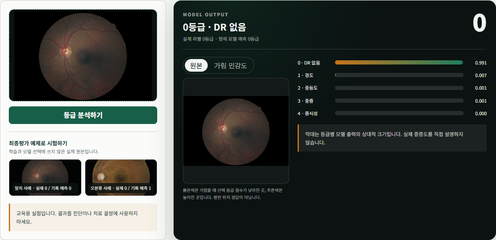
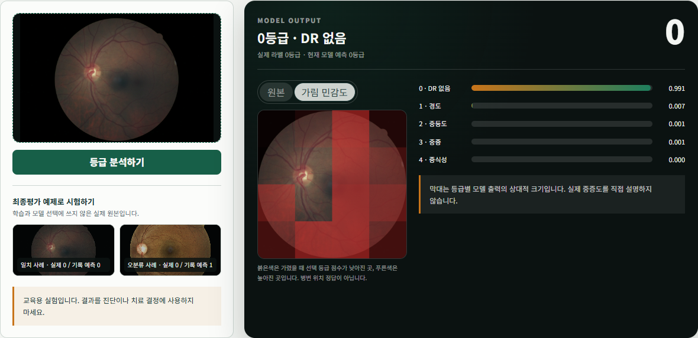
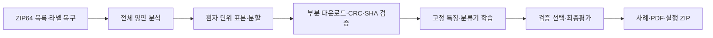

<div align="center">

# Retina Grade Classifier

### 사진 한 장의 예측부터, 그 예측의 한계까지.

안저 이미지의 당뇨망막병증 등급을 분류하고<br>
**실제 예제 · 가림 민감도 · 평가 결과 · 데이터 근거**를 함께 보여 주는 연구용 앱

[](https://github.com/dael0207/retina-grade-classifier/actions/workflows/checks.yml)


[**실행 패키지 다운로드**](https://github.com/dael0207/retina-grade-classifier/releases/tag/v1.1.0) ·
[모델 결과](#모델은-얼마나-맞혔나요) ·
[직접 재현하기](#소스에서-직접-재현하기) ·
[짝 프로젝트: 양안 분석 ↗](https://github.com/dael0207/retina-bilateral-analysis)

</div>

<br>



> **교육용 실험입니다.** 등급별 점수는 임상적으로 보정된 진단 확률이 아니며, 이 앱은 의료기기가 아닙니다.

## 무엇을 할 수 있나요?

| 기능 | 실제 동작 |
|---|---|
| **사진으로 등급 분류** | JPEG·PNG를 올리면 DR 0–4등급과 5개 모델 점수를 반환합니다. |
| **사진 없이 체험** | 학습·모델 선택에 쓰지 않은 실제 테스트 사례를 같은 예측 API로 실행합니다. |
| **예측 민감도 살펴보기** | 사진 영역을 가렸을 때 점수가 변하는 위치를 원본과 전환하며 봅니다. |
| **성능을 직접 확인** | 정확도·QWK·macro-F1, 등급별 재현율, 혼동행렬과 다수 등급 기준선을 비교합니다. |
| **근거까지 추적** | 환자 단위 분할, 이미지 수, 무결성 기록, 실행 설정과 보고서를 확인합니다. |

키보드 방향키·Home·End로 탭과 필터를 이동할 수 있으며, 모바일 화면과 동작 줄이기 설정을 지원합니다. 함께 제공되는 양안 분석 화면은 전체 **35,126장**의 라벨을 다룹니다. 분류 모델의 학습·평가 범위는 별도의 **2,000장** 표본입니다.

## 가장 빠르게 실행하기

**사전 준비:** Windows x64, 인터넷 연결, [uv](https://docs.astral.sh/uv/getting-started/installation/).

1. [v1.1.0 릴리스](https://github.com/dael0207/retina-grade-classifier/releases/tag/v1.1.0)에서 **`assignment2.zip`**을 받습니다.
2. ZIP을 모두 풀고 **`START_APP.bat`**을 실행합니다.
3. 브라우저에서 **<http://127.0.0.1:8765>**를 엽니다.

처음에는 전용 가상환경과 CPU 라이브러리를 설치합니다. 이후 포함된 모델로 추론할 때는 외부 AI 계정이나 API 키가 필요하지 않습니다. 사진은 로컬 서버에서 처리하며 업로드 파일로 저장하지 않습니다. 종료는 서버 창에서 `Ctrl+C`입니다.

<details>
<summary><strong>PowerShell에서 직접 실행하기</strong></summary>

```powershell
powershell -ExecutionPolicy Bypass -File .\INSTALL.ps1
.\.venv\Scripts\python.exe -m uvicorn retina.server:app --host 127.0.0.1 --port 8765
```

이 명령은 모델·사례가 포함된 **릴리스 ZIP 폴더**에서 실행합니다. 소스만 clone한 경우에는 아래 재현 절차가 먼저 필요합니다.

</details>

## 모델은 얼마나 맞혔나요?

**1,000명 · 2,000장**을 환자 단위로 나눴습니다. 같은 사람의 두 눈은 항상 같은 분할에 속합니다.

| 분할 | 환자 | 이미지 | 용도 |
|---|---:|---:|---|
| 학습 | 700 | 1,400 | 특징 표준화와 분류기 학습 |
| 검증 | 150 | 300 | 후보 두 개 중 모델 선택 |
| 최종평가 | 150 | 300 | 선택 이후 한 번 평가 |

| 최종평가 지표 | 선택 모델 | 다수 등급 기준선 |
|---|---:|---:|
| 정확도 | **66.33%** | 74.33% |
| Quadratic weighted kappa | **0.3167** | 0.0000 |
| Macro-F1 | **0.3425** | 0.1706 |

**잘 안 된 부분도 공개합니다.** 1·3등급의 재현율은 0이었고, 4등급의 60%는 단 5장 중 3장을 맞힌 결과입니다. 정확도는 다수 등급 기준선보다 낮습니다. 소수 등급을 안정적으로 구별하는 모델로 해석할 수 없습니다.

모델은 ImageNet 사전학습 **MobileNetV3 Small의 고정 특징**과 **로지스틱 회귀**로 구성됩니다. 검증 QWK, 동점이면 macro-F1로 가중치 없는 후보와 balanced 후보를 비교해 balanced 후보를 선택했습니다. v1 최종평가 결과를 확인한 뒤 재학습이나 추가 모델 선택은 하지 않았습니다.

<details>
<summary><strong>등급별 재현율과 테스트 표본 수</strong></summary>

| 등급 | 의미 | 테스트 이미지 | 재현율 |
|---|---|---:|---:|
| 0 | DR 없음 | 223 | 83.86% |
| 1 | 경증 | 21 | 0.00% |
| 2 | 중등도 | 44 | 20.45% |
| 3 | 중증 | 7 | 0.00% |
| 4 | 증식성 | 5 | 60.00% |

전체 평가 수치는 [metrics.json](docs/results/metrics.json), 실험 설명은 [과제 2 보고서 원문](docs/assignment2_report.md)에 있습니다. 실행 ZIP의 `report.pdf`는 8쪽 보고서입니다.

</details>

## 민감도 그림은 어떻게 읽나요?



4×4 영역을 차례로 가리고 선택 등급의 점수 변화를 측정합니다. **빨강**은 해당 영역을 가릴 때 점수가 낮아진 곳, **파랑**은 점수가 높아진 곳입니다. 이것은 모델 반응이며 병변 위치의 정답이나 의학적 인과 설명이 아닙니다.

## 소스에서 직접 재현하기

```powershell
git clone https://github.com/dael0207/retina-grade-classifier.git
cd retina-grade-classifier
powershell -ExecutionPolicy Bypass -File .\REPRODUCE.ps1
```

`uv.lock`은 Windows x64 · Python 3.12 · CPU 환경을 고정합니다. 필요한 이미지 약 2.16GB를 부분 다운로드하며 네트워크·디스크와 CPU 학습 시간이 필요합니다. 전체 89GB ZIP을 내려받지는 않습니다. 다운로드 접근은 원본 공유 상태에 따라 달라질 수 있습니다.



학습 코드가 실행 설정, 실제 이벤트 로그, 분할 통계와 파일 해시를 기록합니다. 제출된 v1의 기존 로그는 복원 요약임을 명시해 보존했습니다. 기존 결과를 바꾸지 않고 확인하려면 릴리스 ZIP을 사용하세요.

## 코드와 검증

```text
retina/             분석·데이터 검증·학습·API·보고서·패키징
model_runtime/      NumPy·PyTorch·scikit-learn 실행 경계
web/                실제 데이터에 연결된 웹 인터페이스
tests/              합성 fixture 및 선택적 원본 자료 회귀 검사
scripts/            실제 Chrome 반응형·상호작용 QA
typings/            사용 중인 외부 API의 제한된 타입 정의
docs/               결과 요약·보고서 원문·화면·설계
```

```powershell
uv sync --locked
uv run --frozen pytest -q
uv run --frozen ruff check retina model_runtime tests scripts
uv run --frozen basedpyright
```

제출 버전의 로컬 검증은 **58 passed, 2 skipped**, 원본 자료 없는 소스 전용 검증은 **56 passed, 4 skipped**였습니다. 선택적 PDF 텍스트 추출 도구와 원본 자료가 없는 검사는 건너뜁니다. 정적 타입 오류는 0건이며, 375·768·1280px의 실제 브라우저 QA와 독립 화면 검토를 통과했습니다. 현재 원격 실행 결과는 [GitHub Actions](https://github.com/dael0207/retina-grade-classifier/actions)에서 확인할 수 있습니다.

## 데이터와 프로젝트 범위

제공 자료에는 `image`와 DR `level`만 있어 **망막나이 예측을 포함하지 않습니다.** 안저 여부·화질·분포 밖 입력을 판별하는 별도 모델도 없습니다.

Git에는 소스, 화면 설명과 집계 결과를 보관합니다. 원본 영상·라벨·가중치·대용량 실행 파일은 Git 이력에서 제외하고, 검증된 실행 패키지는 접근 제한된 릴리스로 구분합니다. 재배포 권한을 부여하는 뜻은 아닙니다.

[데이터 출처와 이용 범위](DATA_LICENSE.md) · [참고 프로젝트 비교](docs/REFERENCE_COMPARISON.md) · [디자인 계약](DESIGN.md) · [검증 기록](QA_SUMMARY.md)

---

**같은 데이터, 다른 질문.** 전체 양안의 라벨 관계는 [Retina Bilateral Analysis](https://github.com/dael0207/retina-bilateral-analysis)에서 확인할 수 있습니다.
